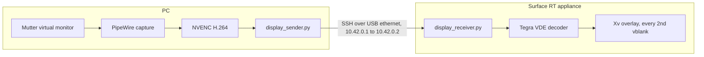

# RT-monitor

RT-monitor turns a Microsoft Surface RT (NVIDIA Tegra 3) into a second monitor for a Linux PC. The PC adds a 1366x768 virtual monitor to the GNOME desktop, encodes it as H.264 on the NVIDIA GPU, and sends it over a direct ethernet link. The Surface decodes each frame on the Tegra video decoder and shows it at the panel's native resolution.

The Surface boots a minimal appliance OS built from this repository. That OS runs no desktop, only SSH, Xorg, and the receiver. postmarketOS (called Nura here) stays installed as a fallback and recovery OS.

## What works

These numbers come from `lab/` runs on the appliance OS:

| Measurement | Result |
| --- | --- |
| Presented frames per second | 30.0 |
| Frame intervals that are exactly 2 vblanks | 94% |
| Decoder time per frame, median | 18.6 ms (stock kernel: 30.8 ms) |
| Capture to visible on the Surface, median and p95 | 80 ms and 99 ms |
| Decoded frames identical to the stock decoder | 300 of 300 |

The panel refreshes at 61.78 Hz, not 60 Hz. At 30 frames per second, about 6% of frames wait 3 vblanks instead of 2, so motion is not perfectly even. The PC mouse cursor is part of the video, so it moves at 30 frames per second and lags by the same 80 ms.

## Limits

- The owner reports successful Power-only internal EFI boot with release `4864cffb6f74e79c22c52c17`, confirmed as the running release over pinned SSH. Startup to the display takes more than five minutes by the owner's estimate; the slow stage is not yet measured. The [internal EFI installer](docs/install.md#install-internal-efi) changes files on the boot filesystem, not SPI or eMMC hardware boot partitions. Keep the rescue USB and APX recovery assets.
- The Surface has one USB port. APX recovery uses the A-to-A cable; normal internal EFI boot and streaming leave the ethernet adapter connected.
- Speakers, microphone, cameras, Wi-Fi, and touch input forwarding do not work on the appliance.
- Scripts hard-code this device: boot partition UUID `17C0-8631`, SSH host key in `surface-known-hosts`, IP addresses `10.42.0.1` and `10.42.0.2`, and user `user` with UID 10000.

## Repository layout

| Path | Contents |
| --- | --- |
| `surface-gud/` | PC sender, Surface receiver, Xv presenter, the PC user service, and the audio tunnel |
| `appliance/` | Build, install, boot-select, recovery, and verification scripts for the appliance OS |
| `appliance/overlay/` | Files copied over the Alpine root filesystem |
| `bootloader/` | Boot configuration table (BCT) for this Surface and the U-Boot boot menu patch |
| `tegra-vde-cache-sync/` | Kernel patch that skips a redundant cache sync in the Tegra video decoder |
| `lab/` | Latency, replay, and checksum tests |
| `surface-kernel.config` | Kernel configuration, identical to the one Nura runs |

Git ignores `nura/` (postmarketOS images and device backups), `u-boot/`, `tegra30_debrick/`, `build-deps/`, and `.venv/`. See the install guide for how to set them up.

## Documentation

- [Install RT-monitor](docs/install.md) sets up the PC, builds the appliance OS, and boots it for the first time.
- [Use and maintain RT-monitor](docs/operate.md) covers daily power-on, switching to Nura and back, recovery, updates, and measurements.
- [Appliance design](appliance/DESIGN.md) explains why the appliance OS is built this way.
- [Decision log](appliance/decisions.tsv) records each build and test step with its evidence.
- [Display stream details](surface-gud/README.md) describes the sender and receiver protocol.
